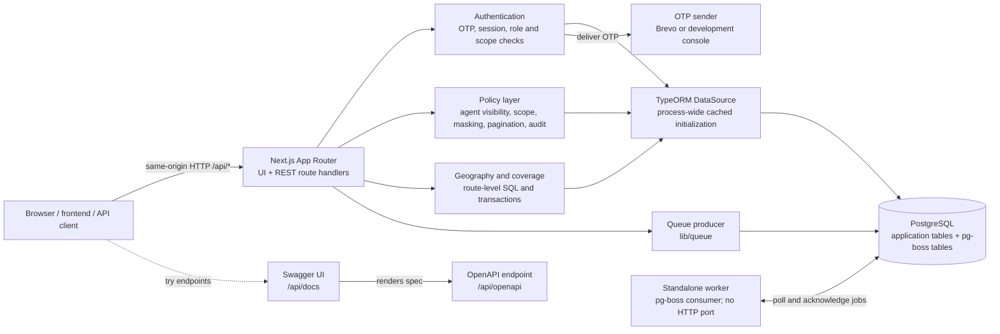

# Backend system design

## System overview



### Request and data flow

1. A client sends an HTTP request to a Next.js route handler. Authentication routes establish or revoke the session; protected routes validate it before accessing protected data.
2. Agent-list requests go through `lib/policy`: the policy layer applies scope and owner visibility in the database query, masks phone numbers, paginates results, and writes the read audit record within its transaction.
3. Geography and coverage handlers currently build their SQL in the route and use the authenticated context's DataSource. Assignment create/delete operations check scope and ownership and write their audit records in the same transaction.
4. The TypeORM DataSource connects to PostgreSQL. Schema changes are applied using migrations; automatic schema synchronization is disabled.
5. Queue producers write jobs to pg-boss tables in PostgreSQL. The separate worker consumes those jobs and does not serve HTTP. At present, only the `test-job` queue has a registered handler; business jobs are future work.
6. `/api/docs` loads the OpenAPI definition from `/api/openapi`. That endpoint uses `SERVER_BASE_URL` when it is configured.

The REST API exists independently of page rendering. Treat the route paths and request/response definitions in the OpenAPI document as the integration contract; confirm the frontend calls a route before assuming a screen is wired to it.

### Main API areas

| Area | Routes | Purpose |
| --- | --- | --- |
| Authentication | `/api/auth/otp/request`, `/api/auth/otp/verify`, `/api/auth/session`, `/api/auth/logout`, `/api/auth/permissions` | Sign-in, session lifecycle, and permissions |
| Geography | `/api/geography/*` | States, LGAs, wards, and polling-unit details |
| Agents | `GET /api/agents` | Policy-filtered, paginated agent list |
| Coverage | `/api/coverage/*` | Coverage summaries, gaps, and assignment mutations |
| Operations | `/api/health`, `/api/dev/queue-test` | Health check and development-only queue smoke test |

JSON API successes use the shared `{ status: "success", data }` envelope, with optional `meta` for pagination. Failures use `{ status: "error", error: { code, message, fields? } }`. The HTML docs page and YAML OpenAPI document are content responses, not JSON API envelopes. The OpenAPI specification documents these response shapes.

## Authentication

### OTP sign-in and session lifecycle

```mermaid
sequenceDiagram
  autonumber
  actor User as User / browser
  participant API as Next.js auth routes
  participant DB as PostgreSQL
  participant Sender as OTP sender

  User->>API: POST /api/auth/otp/request { email }
  API->>DB: Find eligible person and membership/candidate
  API->>DB: Increment email and IP rate-limit buckets
  API->>API: Generate six-digit OTP; HMAC-SHA256 with AUTH_SECRET
  API->>DB: Store OTP hash and expiry (10 minutes)
  API->>Sender: Send OTP by email
  Sender-->>User: One-time code

  User->>API: POST /api/auth/otp/verify { email, code }
  API->>DB: Apply verification IP rate limit; load latest OTP
  API->>API: Check expiry/consumption and compare OTP hashes
  API->>DB: Mark OTP consumed; store SHA-256 hash of new session token
  API-->>User: Set HttpOnly session cookie

  User->>API: Request protected route with cookie
  API->>DB: Hash cookie token and load session + memberships/scopes
  API->>API: Check revoked, absolute expiry, idle timeout, and permissions
  API->>DB: Read/write only data allowed for caller
  API-->>User: Route response

  User->>API: POST /api/auth/logout
  API->>DB: Delete session by token hash
  API-->>User: Expire cookie
```

### Details for implementers

- **Request a code:** `POST /api/auth/otp/request` accepts an email. The address is normalized and must match a person with a membership or candidate record. Rate limits are five requests per email per hour and twenty per IP per hour. The email bucket uses a SHA-256 hash rather than the raw address.
- **OTP storage:** The OTP is six digits. Only an HMAC-SHA256 hash of `personId:code`, keyed with `AUTH_SECRET`, is stored; the OTP expires after ten minutes.
- **Verify a code:** `POST /api/auth/otp/verify` accepts email and a six-digit code. It checks the most recent OTP for that person, rejects consumed or expired codes, and compares hashes with a timing-safe comparison. Verification is rate-limited to ten requests per IP per fifteen minutes.
- **Session token:** A successful verification creates a cryptographically random 32-byte token. The raw token is sent only in the cookie; the database stores its SHA-256 hash. The cookie is `HttpOnly`, `SameSite=Lax`, path `/`, and `Secure` in production.
- **Session validity:** The session has a twelve-hour absolute lifetime and a two-hour idle timeout. Protected requests load the matching hash, check expiry/revocation/idle time, refresh `last_active_at`, and load memberships and scopes for authorization.
- **Permissions and visibility:** Admin and party memberships grant global coverage access; other users are restricted by membership scope. Assignment changes additionally check whether the caller can manage the selected group or candidate. `GET /api/agents` applies the policy layer's visibility rules and returns masked phone numbers.
- **Logout:** `POST /api/auth/logout` deletes the database session matching the cookie token hash and expires the cookie.
- **OTP delivery:** The sender is selected by `OTP_DELIVERY`; Brevo uses the configured email provider, while the console sender is development-only and refuses production.
- **Configuration:** `AUTH_SECRET` must be at least 32 characters. `SERVER_BASE_URL` supplies the OpenAPI server URL for the Swagger UI.

### Current implementation caveats

- Each OTP allows `OTP_MAX_ATTEMPTS` (5) wrong guesses: the verify handler increments `login_otp.failed_attempt_count` and consumes the code on the last failure. Verification is additionally limited per IP and per email.
- `OTP_REQUEST_MIN_RESPONSE_MS` is declared, but the request handler does not currently pad its response time.
- `assertSameOrigin` exists, but the OTP request/verify handlers do not currently call it. Do not treat the cookie's `SameSite=Lax` setting as an explicit Origin check.
- `TRUST_PROXY` defaults to false. Configure proxy trust only when the application is behind a trusted proxy that controls `X-Forwarded-For`; otherwise the IP-based limiter sees the fallback IP value.
